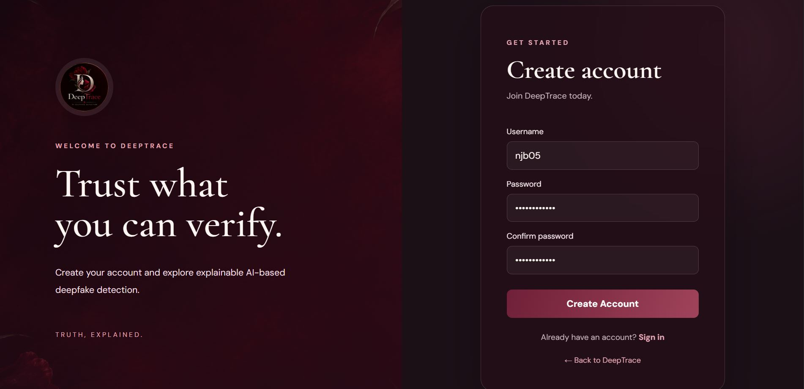
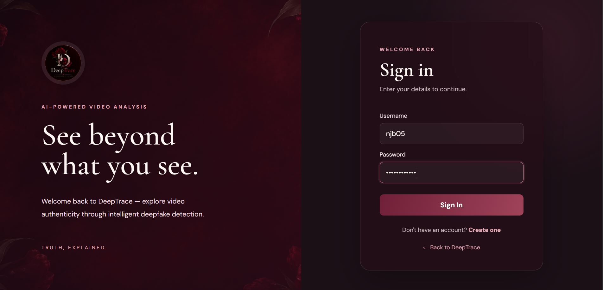
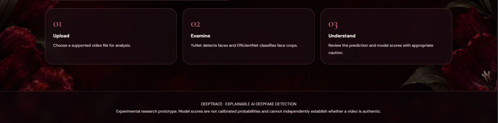
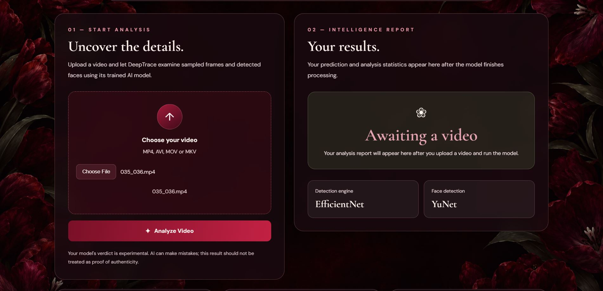
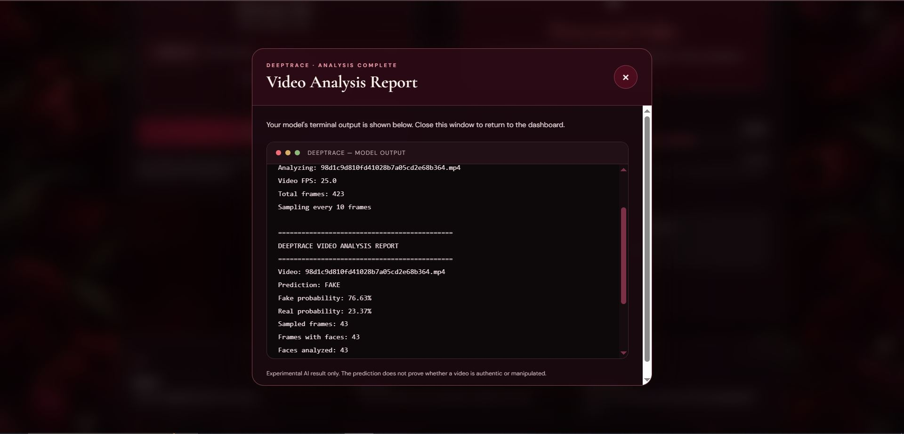

# DeepTrace — AI-Powered Deepfake Video Detection

DeepTrace is an experimental web application that analyzes videos to identify potential deepfake content using deep learning and computer vision. It combines face detection, facial image classification, video-level prediction, and Grad-CAM explainability in a Django-based interface.

## 📌 Project Overview

DeepTrace aims to help users examine video authenticity by detecting faces across video frames and analyzing facial crops using a trained EfficientNet-B0 model.

## ✨ Features

- **Video Analysis:** Upload a video for deepfake analysis.
- **Face Detection:** Uses YuNet to detect faces in video frames.
- **Deep Learning Classification:** Uses EfficientNet-B0 to classify detected face crops.
- **Video-Level Prediction:** Aggregates frame-level predictions into an overall video result.
- **Explainable AI:** Uses Grad-CAM to visualize regions that influence model predictions.
- **User Authentication:** Includes signup and signin pages.
- **Analysis Results:** Presents prediction results and supporting visualizations.

## 🖥️ Application Screenshots

### 1. Home Page

The main interface where users can access the DeepTrace application.


### 2. Sign Up Page

The registration interface for new users.



### 3. Sign In Page

The login interface for registered users.



### 4. Video Analysis Steps

A visual guide to the video analysis process.



### 5. Analysis Page

The interface used to initiate and inspect video analysis.



### 6. Output Page

The interface displaying the analysis output.


### 7. Command-Line Analysis Output

A screenshot of the command-line analysis output.



## 🛠️ Technology Stack

| Component            | Technology                   |
| -------------------- | ---------------------------- |
| Backend              | Python, Django               |
| Deep Learning        | PyTorch                      |
| Classification Model | EfficientNet-B0              |
| Face Detection       | YuNet, ONNX                  |
| Video Processing     | OpenCV                       |
| Explainable AI       | Grad-CAM                     |
| Frontend             | HTML, CSS, JavaScript        |
| Dataset              | FaceForensics++ (c23 subset) |

## 🔄 How It Works

1. The user uploads a video through the web interface.
2. The video is processed to extract frames.
3. YuNet detects faces in selected frames.
4. Detected faces are prepared as input for EfficientNet-B0.
5. The model generates predictions for individual face crops.
6. Predictions are aggregated to produce a video-level result.
7. Grad-CAM can provide visual explanations of model predictions.
8. The application presents the analysis results to the user.

## 📊 Dataset and Experimental Results

The project uses a subset of the FaceForensics++ dataset with c23 compression.

- Original videos: 50
- Fake videos: 50
- Extracted face crops: 5,878
- Training face crops: 3,784
- Validation face crops: 638
- Testing face crops: 1,456
- Face-crop test accuracy: 66.48%
- Video-level test accuracy: 80% (16 out of 20 videos)

These are experimental results from the project's evaluation setup. They should not be interpreted as proof of reliable performance on arbitrary real-world videos.

## ⚙️ Installation and Setup

### Prerequisites

- Python 3.12 or a compatible Python version
- Git
- pip

### 1. Clone the repository

```bash
git clone https://github.com/niranjanabaalu/DeepTrace.git
cd DeepTrace
```

### 2. Create a virtual environment

**Windows:**

```bash
python -m venv venv
venv\Scripts\activate
```

### 3. Install dependencies

```bash
pip install -r requirements.txt
```

### 4. Apply database migrations

```bash
python manage.py migrate
```

### 5. Start the development server

```bash
python manage.py runserver
```

Open the local development address shown in the terminal, usually:

`http://127.0.0.1:8000/`

**Note:** A fresh installation may also require the trained model checkpoint, YuNet ONNX model, and any additional configuration or data files. Follow the project's model setup instructions if these files are not included in the repository.

## ⚠️ Limitations

- DeepTrace is an experimental academic project, not a certified forensic tool.
- Model accuracy may vary across datasets, compression levels, lighting conditions, and video sources.
- The current experimental results do not establish reliable real-world detection performance.
- Predictions should not be treated as definitive proof that a video is real or fake.

## 🚀 Future Enhancements

- Improve model performance using larger and more diverse datasets.
- Evaluate generalization across unseen deepfake generation techniques.
- Optimize inference speed for longer videos.
- Improve the presentation of confidence scores and explainability visualizations.
- Add more comprehensive testing and evaluation.

## 👩‍💻 Author

**Niranjana B.**

- GitHub: [niranjanabaalu](https://github.com/niranjanabaalu)

---

_DeepTrace is developed for academic learning and experimental research into deepfake video detection._
